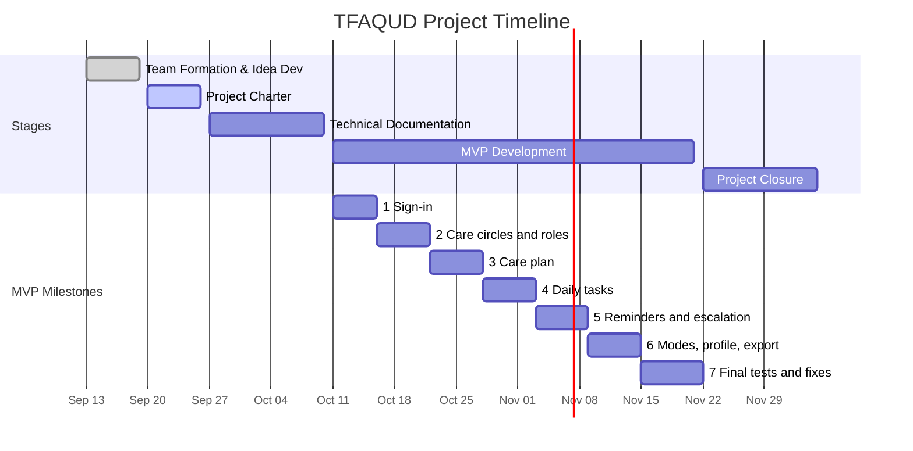

# Stage 2: Project Charter

**Project Name:** TFAQUD | تفقُّد

**Project Overview:** TFAQUD is a mobile application designed to organize healthcare through care circles, each built around a single patient. A user can belong to several care circles, with a different role in each, and so care for more than one patient in one application. Each circle brings medication management, medical appointments, therapy sessions, and health measurements into one care plan, while supporting reminders, follow-up of missed tasks, care documentation, and coordination among care circle members according to their roles.

---

## 1. Project Objectives

### 1.1 Project Purpose
 
To develop a mobile application for iOS and Android that simplifies the organization and monitoring of healthcare for a single patient, whether the patient manages their own care or receives support from family caregivers in a care circle.

### 1.2 SMART Objectives
- Provide a simple and centralized place to manage medications, appointments, and health measurements: all three can be added with a schedule and recorded in the MVP by November 21, 2026.
- Help reduce missed medications and appointments through reminders and follow-up of missed tasks: every scheduled item produces a reminder, and a missed task notifies the configured recipients in order, confirmed by tests by November 21, 2026.
- Enable the members of a care circle to coordinate and divide care responsibilities with a clear role and permissions for each member: every action is refused for a role that is not allowed to perform it, confirmed by tests by November 21, 2026.

---

## 2. Stakeholders and Team Roles

### 2.1 Stakeholders

| Classification | Stakeholder | Relationship to the Project |
|---|---|---|
| Internal | Project Team: Alanoud Aloraydi, Lama Alzahrani, and Leen Algraawi | Plan and develop TFAQUD, prepare project deliverables, and make project decisions collaboratively. |
| Internal | Holberton Monitors | Follow the team's progress and review project deliverables as part of Holberton's academic assessment process. |
| External | Patients | Intended users who either manage their own care independently, follow their daily tasks through Simplified Mode, or receive assistance from caregivers. |
| External | Caregivers | Intended users who organize and coordinate care for a single patient as care managers or care assistants, or follow the care as viewers. The primary target audience includes groups of two or more caregivers sharing caregiving responsibilities. |

### 2.2 Team Roles and Responsibilities

| Role | Assigned Member(s) | Responsibilities |
|---|---|---|
| Team Lead | Alanoud Aloraydi | Coordinate task assignments, facilitate technical discussions, and ensure the integration of the team's work. |
| Project Manager | Lama Alzahrani | Organize meetings, track project progress and deadlines, and identify obstacles that may affect delivery. |
| Backend QA | Leen Algraawi | Test the back end through unit, integration, and API tests, verify that each endpoint enforces role permissions and returns the expected errors, and report defects to the team. |
| Developer | All Team Members | Collaborate on application development and participate in project documentation and work reviews. |

---

## 3. Project Scope

### 3.1 In Scope

A mobile application for iOS and Android with Arabic language support, designed to manage the care of a single patient through a care circle. The application includes medication management, medical appointments, health measurements, reminders and escalation of missed tasks, two application modes (Detailed and Simplified), care circle coordination with defined roles and permissions, the patient's medical profile with an emergency card, and export of the care record.

### 3.2 Out of Scope

The application does not support integration with hospital systems or electronic medical records, automated medical diagnosis or clinical data interpretation, or automatic data import from medical devices. It also does not support web or desktop platforms.

---

## 4. Risks and Mitigation Strategies

The team identified potential risks that could affect the reliability, usability, and timely delivery of TFAQUD. The following mitigation strategies are proposed to reduce their likelihood or impact.

| Risk | Mitigation Strategy |
|---|---|
| **Incorrect Medication Information:** Inaccurate medication details entered by users or read from a photo may result in reminders or schedules that do not match the original instructions. | Use clearly defined input fields, require users to review medication details before saving, and validate required information. |
| **Inconsistent Treatment Updates:** Changes to a medication's dosage or status may not be reflected consistently across schedules, reminders, and medication history. | Define how treatment changes affect related records, preserve medication history, and test medication update and discontinuation scenarios. |
| **Conflicting Caregiver Updates:** Simultaneous actions by multiple caregivers may overwrite information or create duplicate records. | Implement appropriate server-side conflict handling, prevent duplicate operations, and test concurrent updates. |
| **Inaccurate Dose Status:** The application may incorrectly treat a reminder as confirmation that medication was taken, leading to misleading follow-up records. | Distinguish reminder delivery from user-confirmed dose status and generate summaries only from recorded information. |
| **Unclear Care Task Handoffs:** Reassigning a task without clearly identifying its current status and responsible caregiver may leave the task unattended. | Define task assignment and reassignment rules, make responsibility visible, and test scenarios involving declined or incomplete tasks. |
| **Unreliable Reminders:** Device restrictions, notification permissions, or technical failures may prevent users from receiving medication or appointment reminders or missed-task alerts. | Handle notification permissions, test reminder and escalation behavior under relevant device conditions, and keep schedules accessible within the application. |
| **Unauthorized Access to Health Information:** Errors in account authorization or care circle role and permission controls may expose patient information to unauthorized users. | Enforce authorization on the backend, restrict access according to assigned roles and permissions, and test unauthorized access and permission changes. |
| **Misleading Health Measurement Displays:** Incorrect units, timestamps, target ranges, or handling of missing values may produce inaccurate measurement records. | Validate measurement inputs, use consistent units and timestamps, and test measurement records against known sample data. |
| **Poor Usability for Target Users:** Patients using Simplified Mode or caregivers managing multiple responsibilities may struggle to complete essential tasks. | Test key user workflows for both application modes, review interface clarity, and refine the design based on usability findings. |
| **Loss or Corruption of Care Records:** Failed saving or recovery operations may cause missing or inconsistent medication and measurement records. | Validate successful data operations, maintain data consistency, and test backup and recovery procedures using sample data. |
| **Integration Failures Between Components:** Inconsistent data handling between the mobile application, REST API, and database may disrupt connected features. | Define API contracts, integrate components incrementally, and test complete workflows across the application and backend. |
| **MVP Scope Expansion:** Adding or substantially changing features during development may delay essential functionality and jeopardize delivery. | Establish the agreed MVP scope, assess proposed changes against available time, and prioritize completion of core features before considering additions. |

---

## 5. High-Level Project Plan

**MVP Milestones and Dependencies**

| # | Milestone | Target Dates | Deliverable | Depends On |
|---|---|---|---|---|
| 1 | Sign-in | 2026-10-11 to 2026-10-15 | Back end, database, and application set up, with sign-in by phone number and one-time code | Technical Documentation |
| 2 | Care circles and roles | 2026-10-16 to 2026-10-21 | Create a care circle for oneself or for a patient (with the patient's approval), invite members, and apply roles and permissions | Milestone 1 |
| 3 | Care plan | 2026-10-22 to 2026-10-27 | Add and schedule medications, appointments, and health measurements in a circle | Milestone 2 |
| 4 | Daily tasks | 2026-10-28 to 2026-11-02 | Daily tasks created from the care plan, recorded by members, and assigned with accept or decline | Milestone 3 |
| 5 | Reminders and escalation | 2026-11-03 to 2026-11-08 | Reminders at the scheduled time and notification of the configured recipients, in order, when a task is missed | Milestone 4 |
| 6 | Modes, profile, and export | 2026-11-09 to 2026-11-14 | Simplified Mode, medical profile with emergency card, and care record export | Milestone 5 |
| 7 | Final tests and fixes | 2026-11-15 to 2026-11-21 | Final tests of the objectives in Section 1.2, fixes, and completion of any unfinished work from earlier milestones | Milestone 6 |
