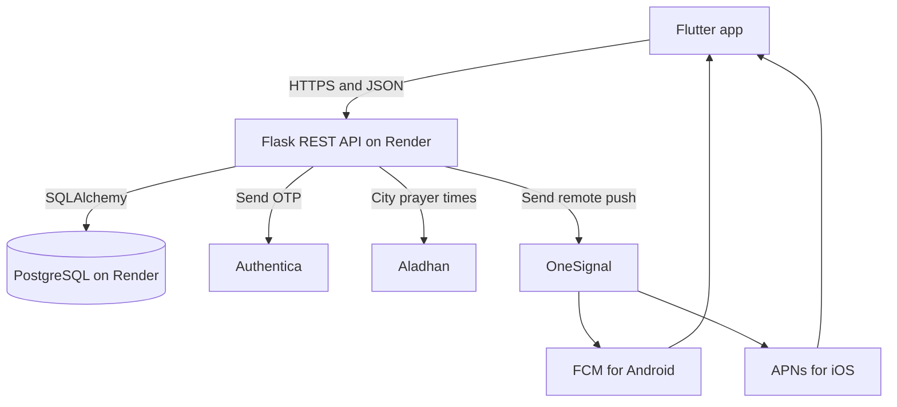
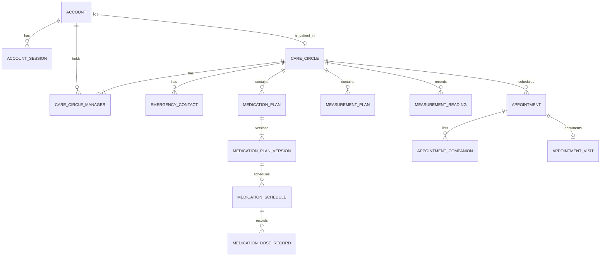
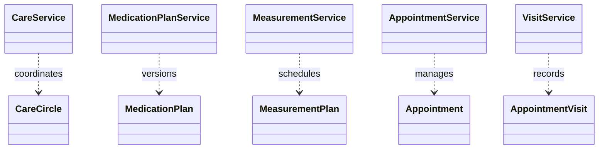
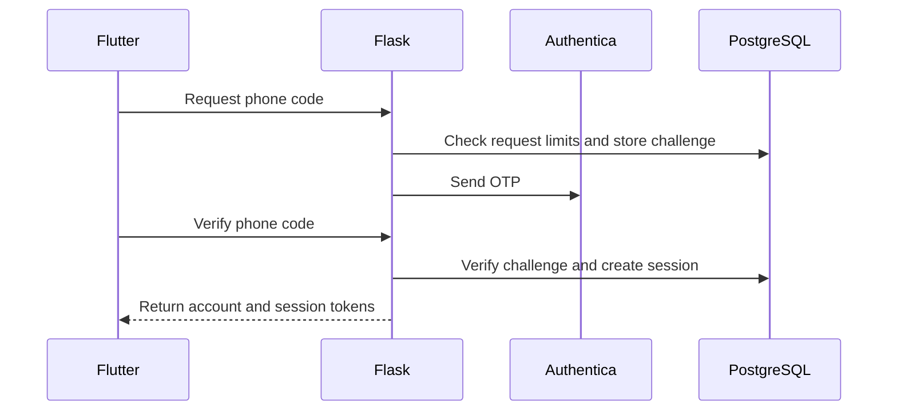
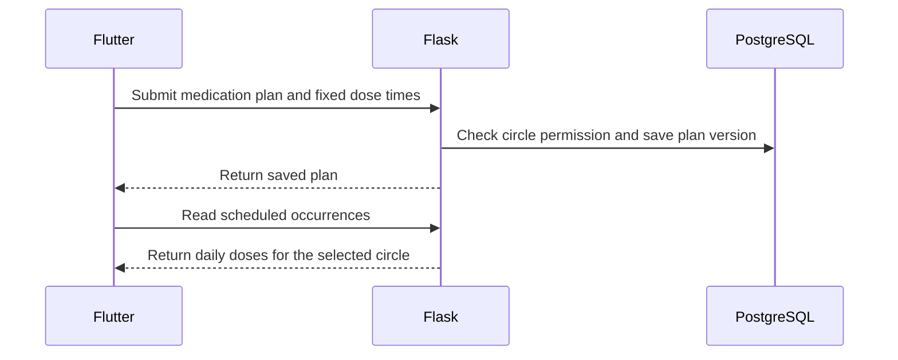

# Stage 3: Technical Documentation

## 1. User Stories and Mockups

| Priority | User Story | Jira |
|---|---|---|
| Must Have | As a patient or caregiver, I want to sign in by phone so I can access my care information. | [TFQD-35](https://holbertonstudents-team-f4bzu0ub.atlassian.net/browse/TFQD-35) |
| Must Have | As a caregiver, I want to create a circle and obtain patient consent when required so I can coordinate care. | [TFQD-29](https://holbertonstudents-team-f4bzu0ub.atlassian.net/browse/TFQD-29) |
| Must Have | As a manager, I want to invite other caregivers so we can share care responsibilities. | [TFQD-84](https://holbertonstudents-team-f4bzu0ub.atlassian.net/browse/TFQD-84) |
| Must Have | As a manager, I want to plan medications, measurements, and appointments so daily care is scheduled. | [Care plan stories](https://holbertonstudents-team-f4bzu0ub.atlassian.net/issues/?jql=key%20in%20(TFQD-92,TFQD-87,TFQD-93)) |
| Must Have | As a patient, I want to view and respond to daily tasks so my circle can follow my care. | [TFQD-90](https://holbertonstudents-team-f4bzu0ub.atlassian.net/browse/TFQD-90) |
| Must Have | As a manager, I want access to the patient's current medical profile and Emergency Card. | [Medical stories](https://holbertonstudents-team-f4bzu0ub.atlassian.net/issues/?jql=key%20in%20(TFQD-32,TFQD-33)) |
| Should Have | As a patient or caregiver, I want reminders and follow-up when care tasks need attention. | [Reminder stories](https://holbertonstudents-team-f4bzu0ub.atlassian.net/issues/?jql=key%20in%20(TFQD-96,TFQD-91)) |
| Should Have | As a manager, I want to review care history, document visits, and export a PDF. | [Care Record stories](https://holbertonstudents-team-f4bzu0ub.atlassian.net/issues/?jql=key%20in%20(TFQD-97,TFQD-98,TFQD-99)) |

Jira records the delivered behavior and linked evidence.

[Full Jira backlog](https://holbertonstudents-team-f4bzu0ub.atlassian.net/jira/software/projects/TFQD/boards/3/backlog) · [Figma mockups](https://www.figma.com/design/Ojd0XVQSuC39YoJoiRyhou/Tafaqud-Care-OS?node-id=0-1)

## 2. System Architecture

Flutter uses presentation, domain, and data modules with Cubit, Dio, and GetIt. The app supports local reminders and generates the Care Record PDF. Flask validates requests, checks circle access, and applies care rules. Alembic manages the PostgreSQL schema.

## 3. Components and Data Model

| Component | Responsibility |
|---|---|
| Auth and Users | Phone OTP, account profile, session refresh, sign-out, and deletion |
| Circles and Authorization | Consent, invitations, membership, leadership, and care-plan permissions |
| Home and Care | Circle selection, daily tasks, and task responses |
| Medications, Measurements, and Appointments | Plan rules, care history, readings, companions, and visit sheets |
| Medical and Reminders | Patient information, Emergency Card, local reminders, and external push |

The circle holds one patient. A patient with an account uses the account's identity fields. The circle stores those fields for a patient without an account. Managers may have plan-specific edit permissions. The API also distinguishes a detailed member with paused editing access and a patient in Simplified Mode. The database checks that an active circle retains a manager.

[Flutter features](../app/lib/features/) · [Back-end models](../backend/app/models/) · [Migrations](../backend/migrations/versions/)

### Back-end Classes

| Class | Responsibility |
|---|---|
| `CareService` | Circle creation, membership, and consent workflows |
| `MedicationPlanService` and `MedicationDoseService` | Plan versions, schedules, and dose records |
| `MeasurementService` | Measurement plans and readings |
| `AppointmentService` and `VisitService` | Appointments, companions, and visit records |

## 4. Main Request Flows

## 5. API Specifications

Routes below are relative to `/api/v1`. Account and circle routes require a session. Circle actions apply server-side authorization.

| Method | Path | Purpose |
|---|---|---|
| GET | `/health` | Check API and configured database schema |
| POST | `/auth/request-code`, `/auth/verify-code` | Request and verify OTP |
| POST | `/auth/refresh`, `/auth/sign-out` | Refresh or revoke a session |
| GET, DELETE | `/accounts/me` | View or delete the account |
| PUT | `/accounts/me/profile` | Update the signed-in profile |
| GET | `/home` | Load authorized circles |
| POST | `/circles/self`, `/circles/patient-without-account` | Create a circle |
| GET, POST | `/circle-requests` | Read or send a patient consent request |
| POST | `/circle-requests/{request_id}/respond` | Accept or decline a request |
| GET, PATCH | `/circles/{circle_id}/medical-profile` | View or update the medical profile |
| GET | `/circles/{circle_id}/emergency-card` | Read the derived Emergency Card |
| GET, POST | `/circles/{circle_id}/medication-plans` | List and create medication plans |
| GET, POST | `/circles/{circle_id}/measurement-plans` | List and create measurement plans |
| GET, POST | `/circles/{circle_id}/appointments` | List and create appointments |
| GET, POST | `/circles/{circle_id}/measurement-readings` | List readings or record an unscheduled reading |
| GET, PUT | `/circles/{circle_id}/appointments/{appointment_id}/visit` | Read or save visit text |
| GET, PUT, DELETE | `/circles/{circle_id}/appointments/{appointment_id}/visit/audio` | Read, replace, or delete the protected voice note |
| GET | `/circles/{circle_id}/prayer-times` | Get prayer times for the patient city |
| PUT | `/accounts/me/push-subscription` | Register or update remote push settings |

OTP request throttling checks the phone number, caller IP, and installation ID. Verification uses challenge-level limits. Medication recurrence uses fixed clock times. The Today screen uses prayer periods for grouping. Appointment companions are optional and selected from eligible circle managers. Visit audio is stored in PostgreSQL.

[API registration and configuration](../backend/app/factory/) · [Back-end setup](../backend/README.md)

### Error Responses

| HTTP status | Meaning |
|---|---|
| 400, 422 | Malformed request or invalid input |
| 401, 403 | Session required or permission denied |
| 404, 409 | Resource unavailable or state conflict |
| 429, 503 | Request limit or temporary service failure |

## 6. SCM, QA, and Deployment

| Area | Practice |
|---|---|
| SCM | Integrate changes on `development` and merge to `main` through pull requests. App and Backend checks are required on `main`. |
| Definition of Done | Link the Jira issue, verify authorization and validation, include required migrations, pass relevant checks, and record peer review and acceptance evidence. |
| Automated QA | Use pytest for Flask and PostgreSQL integration tests and Flutter tests for units and widgets. |
| Device QA | Use the smoke workflow for device coverage. Verify release flows separately on signed tester builds connected to Render. |
| Deployment | Render hosts Flask and PostgreSQL for the beta. Signed iOS builds are uploaded to TestFlight. CI produces the signed Android AAB. |

[CI workflow](../.github/workflows/ci.yml) · [Device workflow](../.github/workflows/device-matrix.yml) · [Stage 4 evidence](stage-4-mvp-development-and-execution.md)

## 7. Technical Rationale

- Flutter provides one codebase for iOS and Android and supports the Arabic interface.
- Flask separates care rules and authorization from the mobile app.
- PostgreSQL enforces relationships and supports atomic updates across linked care records.
- Circle permissions protect patient data. Simplified Mode reduces the steps for daily follow-up.
- Reminder delivery and task completion are tracked separately. Care Record export supports review and sharing.
